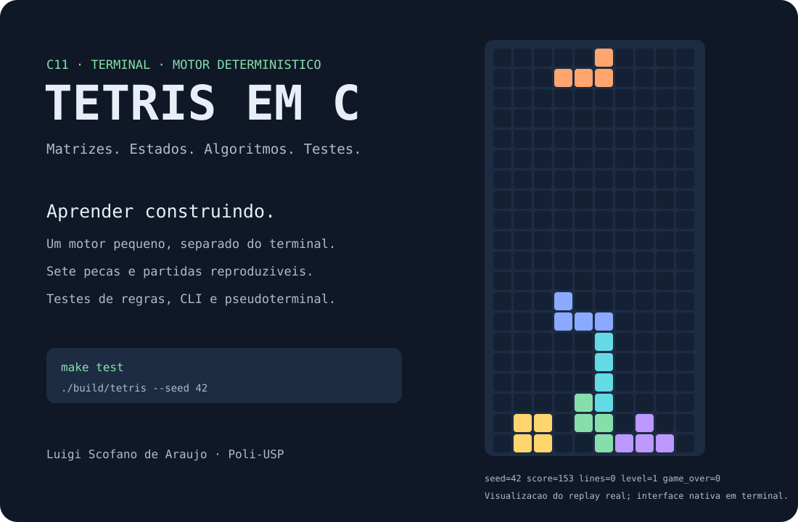

<p align="center"></p>

# Tetris em C

[](https://github.com/luigiscofano/tetris-c/actions/workflows/ci.yml)


**Um jogo de blocos para estudar programação em C: matrizes, transformações, estados e testes automatizados.** Motor independente do terminal, sete peças, próxima peça, queda automática, pontuação, níveis, pausa e partidas reproduzíveis por seed.

> **Procedência:** esta é uma implementação nova de portfólio, preparada em 2026 com assistência de IA. Luigi relata ter desenvolvido um Tetris em C na faculdade, mas o arquivo original e o enunciado não foram recuperados. Este repositório não é uma cópia autenticada da entrega de MAC2166/EP3. [Contexto e procedência →](docs/PROCEDENCIA.md)

## Comece por aqui

| Quero… | Caminho |
| --- | --- |
| Jogar agora | [Instalação e execução](docs/INSTALACAO.md) |
| Entender os controles e regras | [Guia do jogador](docs/REGRAS.md) |
| Ver o que se aprende | **[Objetivos pedagógicos](docs/OBJETIVOS_PEDAGOGICOS.md)** |
| Entender a implementação | [Arquitetura](docs/ARQUITETURA.md) e [algoritmos](docs/ALGORITMOS.md) |
| Conferir se funciona | [Testes e limites](docs/VALIDACAO.md) |
| Reproduzir uma partida | [Exemplos](examples/README.md) |
| Apresentar o projeto | [Roteiro de apresentação](docs/APRESENTACAO.md) |

## Executar

Precisa de compilador C11 e GNU Make. Python 3 é usado nos testes e na geração do preview.

```sh
git clone https://github.com/luigiscofano/tetris-c.git
cd tetris-c
make
./build/tetris --seed 42
```

Use um terminal ANSI com pelo menos **80 colunas e 30 linhas**. No Windows, consulte a [configuração MSYS2/UCRT64](docs/INSTALACAO.md). Para uma demonstração sem terminal interativo:

```sh
make demo
make test
```

| Tecla | Ação |
| --- | --- |
| A / D ou ← / → | Mover |
| W ou ↑ / Z | Girar horário / anti-horário |
| S ou ↓ | Descer uma linha |
| Espaço | Queda imediata |
| P / R / Q | Pausar / reiniciar / sair |

## Objetivos pedagógicos em destaque

O propósito principal é **aprender a transformar regras em um programa verificável**:

- Representar um tabuleiro com matrizes e separar estado permanente de peça ativa.
- Transformar coordenadas para rotação sem escrever quatro implementações diferentes.
- Validar movimentos antes de modificar o estado.
- Compactar linhas preservando a ordem das restantes.
- Separar lógica de domínio de teclado, relógio e desenho.
- Reproduzir falhas por seed e replay e verificar invariantes com testes.

Cada objetivo tem uma atividade e uma evidência observável em [OBJETIVOS_PEDAGOGICOS.md](docs/OBJETIVOS_PEDAGOGICOS.md). Este é um recurso de estudo de programação; não há avaliação de eficácia pedagógica com participantes.

## Organização

| Diretório | Conteúdo |
| --- | --- |
| [src/](src/README.md) | Motor, aplicação e adaptação do terminal |
| [include/](include/README.md) | Tipos e contratos da API |
| [tests/](tests/README.md) | Regras, CLI, stress e pseudoterminal |
| [examples/](examples/README.md) | Replay comentado e saída de referência |
| [docs/](docs/README.md) | Guias técnicos e pedagógicos |
| [assets/](assets/README.md) | Preview gerado a partir do jogo real |
| [scripts/](scripts/README.md) | Ferramentas de apoio |
| [historico/](historico/README.md) | Situação da recuperação do trabalho original |

## Escopo da versão

Tabuleiro 10 × 20, saco de sete peças, rotação 4 × 4 com tentativas horizontais simples e fixação imediata ao tocar um obstáculo. **Não implementa SRS, hold, ghost, T-spin, combos, multiplayer ou ranking persistente.** As regras específicas estão documentadas para evitar confusão com versões comerciais.

**Luigi Scofano de Araujo · Engenharia de Computação, Poli-USP · USP 13680334**

Projeto independente de estudo, sem afiliação a produtos comerciais. A implementação, seus desenhos e sua documentação são novos; não foram copiados de outro repositório. Consulte [contribuição](CONTRIBUTING.md), [mudanças](CHANGELOG.md) e [limites de validação](docs/VALIDACAO.md).
