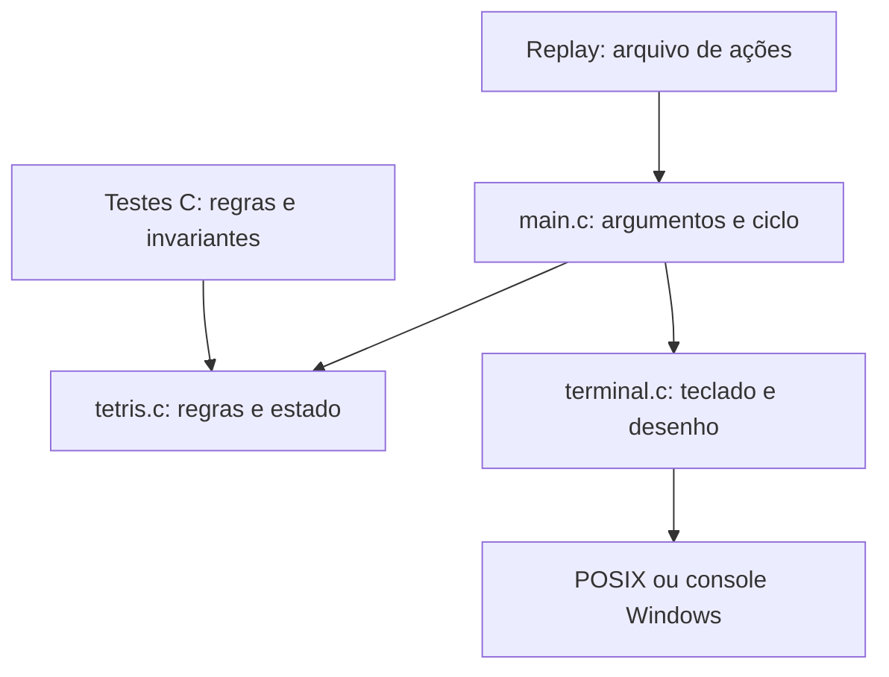

# Arquitetura

A aplicação escolhe um modo de entrada e encaminha ações para o mesmo motor. O motor não depende de sistema operacional, relógio, arquivos, cores ou teclado.

## Modelo de estado

`Tetris` contém tabuleiro de bytes, peça ativa, próxima peça, saco de sete, estado do PRNG, score, linhas e flags de pausa/fim. O tabuleiro guarda 0 para vazio e 1–7 para os tipos fixados. A peça ativa existe separadamente e só é gravada na fixação.

`Piece` contém tipo, orientação e origem x/y da máscara 4 × 4. `tetris_fits` percorre apenas células ocupadas e valida limites antes de indexar o tabuleiro.

## Transições principais

| Estado | Ação | Resultado |
| --- | --- | --- |
| Jogando | Mover/girar válido | Atualiza apenas a peça ativa |
| Jogando | Passo descendente válido | Desce uma linha |
| Jogando | Passo descendente bloqueado | Fixa, compacta, pontua e gera nova peça |
| Jogando | Queda imediata | Desce até o último local livre e fixa |
| Jogando | Pausa | Bloqueia ações do motor |
| Pausado | Pausa | Retoma |
| Jogando | Nova peça bloqueada | Fim de jogo |
| Qualquer | Reinício pela aplicação | Nova inicialização com a seed da sessão |

## Interface e plataforma

POSIX usa `termios`, `select`, `clock_gettime` e `nanosleep`. Windows usa `_getch`, console Win32, `GetTickCount64` e `Sleep`. O terminal usa tela alternativa e restaura as configurações ao sair normalmente ou atender um sinal tratável. Handlers de sinal apenas alteram `sig_atomic_t`; a limpeza ocorre no fluxo normal.

O desenho representa as letras das peças em cores, com duas colunas por célula. Cor é apoio: a letra também identifica o tipo. No replay não há códigos de escape.

## Complexidade e memória

| Operação | Custo |
| --- | --- |
| Colisão/movimento/uma tentativa de rotação | O(16), constante |
| Rotação com cinco tentativas | O(5 × 16), constante |
| Compactação | O(altura × largura) |
| Queda imediata | O(altura × 16) |
| Embaralhar saco | O(7) |
| Desenhar | O(altura × largura) |

O motor não usa `malloc`: o estado e as máscaras têm tamanho fixo. A aplicação usa a biblioteca padrão para arquivos e saída. A API é para uma thread; não existe sincronização para acesso concorrente.
